# RePlay Games — Marketplace web y móvil para la compra y venta de videojuegos físicos de segunda mano

# Presentado por:

- *Francisco Javier Reyes Villalón* (Documentación del proyecto y elaboración del README)
- *Tomás Ignacio Moraga Gálvez* (Desarrollo del frontend en Ionic + React)
- *Cristóbal Jesús Pinto Quiroga* (Diseño UI/UX y elaboración del prototipo en Figma)
- *Marco Antonio Fernandoy Rojas* (Gestión del repositorio en GitHub, ramas y commits)

Las siguientes actividades fueron desarrolladas de manera conjunta por todos los integrantes del equipo:
- Definición de requerimientos funcionales y no funcionales.
- Definición de roles y caracterización de usuarios.
- Arquitectura de navegación y flujos de tareas.
- Configuración de rutas públicas, protegidas y acceso por roles.
- Pruebas de navegación y funcionamiento general.
- Revisión final de la documentación y coherencia entre Figma, README y frontend.
  

|Tipo |Link |
| :--- | :--- |
| Repositorio | *https://github.com/cristobalpinto2600-cyber/RePlay-Games* |
| Prototipo en Figma | *https://www.figma.com/design/HjfX9dFW7dpfEzYFaPNR0Z/Figma-Web?node-id=0-1&t=1ShxU2N3ZS4MXlIQ-1* |

## Índice

1. [Descripción general del sistema](#descripción-general-del-sistema)
2. [Objetivo del proyecto](#objetivo-del-proyecto)
3. [Principales funcionalidades](#principales-funcionalidades)
4. [Justificación del problema](#justificación-del-problema)
5. [Entrega EP2: backend, autenticación e integración](#entrega-ep2-backend-autenticación-e-integración)
    - [Alcance y estado de las funcionalidades](#alcance-y-estado-de-las-funcionalidades)
    - [Ramas del repositorio](#ramas-del-repositorio)
    - [Trazabilidad con los requerimientos de EP1](#trazabilidad-con-los-requerimientos-de-ep1)
6. [Usuarios](#usuarios-objetivo-quién-usará-la-aplicación)
    - [Roles](#roles-del-sistema)
    - [Proto-personas](#proto-personas)
    - [Supuestos utilizados](#supuestos-utilizados)
7. [Requerimientos](#requerimientos)
8. [Arquitectura de la Información / UX](#arquitectura-de-navegación)
    - [Diferenciación por roles](#diferenciación-de-acceso-según-roles)
    - [Flujos principales de tareas](#flujos-de-tareas)
    - [Puntos críticos de interacción](#puntos-críticos-de-interacción)
    - [Justificación técnica](#justificación-técnica)
9. [Bocetos UI/UX](#bocetos-uiux)
10. [Frontend con Ionic-React](#frontend-con-ionic-react)
11. [Backend: API REST con Node.js y Express](#backend-api-rest-con-nodejs-y-express)
    - [Tecnologías por capa](#tecnologías-por-capa)
    - [Arquitectura](#arquitectura)
    - [Estructura de carpetas](#estructura-de-carpetas)
    - [Instalación y ejecución](#instalación-y-ejecución)
    - [Documentación de la API](#documentación-de-la-api)
    - [Seguridad](#seguridad-1)
    - [Integración frontend + backend](#integración-frontend--backend)
    - [Pruebas con Postman](#pruebas-con-postman)
    - [Modelo relacional](#modelo-relacional)
    - [Matriz de cumplimiento EP2](#matriz-de-cumplimiento-ep2)
12. [Librerías y tecnologías](#librerías-usadas-con-react-ionic)
13. [Fuentes](#fuentes)


## Descripción general del sistema

RePlay Games es una aplicación web y móvil orientada a la compra y venta de videojuegos físicos de segunda mano. La plataforma busca centralizar publicaciones especializadas y facilitar la búsqueda, comparación y gestión de operaciones entre usuarios, incorporando además funciones de favoritos, calificaciones, reportes y moderación.

## Objetivo del proyecto

Desarrollar una aplicación web y móvil que facilite la compra y venta de videojuegos físicos de segunda mano mediante una plataforma especializada, clara y adaptable a distintos dispositivos, permitiendo organizar la información de las publicaciones y entregar mayor trazabilidad durante las operaciones.

## Principales funcionalidades

Entre las principales funcionalidades de RePlay Games se encuentran la exploración y filtrado del catálogo, consulta del detalle de publicaciones, publicación y administración de videojuegos, gestión de favoritos, operaciones de compra y venta, calificaciones asociadas a operaciones completadas, reportes de publicaciones y moderación administrativa.

## Justificación del problema

El comercio electrónico constituye un canal relevante en Chile. La Cámara de Comercio de Santiago
informó que durante 2025 las ventas online bordearon los US$ 10 mil millones y crecieron 11,6 %
nominal [1]. En este contexto, los videojuegos físicos usados pueden encontrarse en plataformas
generales de compraventa, pero dichas plataformas deben organizar productos muy distintos entre sí.
Para una persona que busca un videojuego usado resulta útil disponer de información especializada y
comparable, como consola compatible, estado del disco o cartucho, condición de la caja, precio,
ubicación y modalidad de entrega.

SERNAC destaca, en el contexto del comercio electrónico, la importancia de informar de manera clara
el precio, las características relevantes, el stock y las condiciones de entrega [2]. Asimismo,
SERNAC señala que cuando una empresa vende productos usados debe informar expresamente esa
condición [3]. Estas referencias se utilizan como criterios de transparencia para el diseño
académico de la plataforma, sin asumir que todas las obligaciones citadas se aplican de la misma
forma a cada futura operación entre particulares.

También existe una necesidad de señales de confianza. Facebook Marketplace utiliza valoraciones
entre usuarios, pero Meta indica que no verifica necesariamente que la persona que califica haya
comprado el producto o utilizado el servicio [4]. Como decisión de diseño, RePlay Games propone
vincular las calificaciones únicamente con operaciones registradas como completadas dentro del
sistema.

La necesidad abordada es contar con una plataforma especializada que reduzca la dispersión de
información, facilite la comparación de publicaciones y entregue mayor trazabilidad a la compra y
venta de videojuegos físicos usados.

**Consecuencias asociadas al problema:**

- Mayor tiempo de búsqueda al revisar publicaciones poco pertinentes.
- Dificultad para comparar alternativas cuando cada vendedor describe el producto de forma distinta.
- Mayor incertidumbre respecto del estado del juego y de la confiabilidad del vendedor.
- Repetición de preguntas que podrían resolverse con campos estandarizados.
- Menor trazabilidad cuando publicación, acuerdo y seguimiento de la operación quedan dispersos.

## Entrega EP2: backend, autenticación e integración

En EP2 el frontend de EP1 deja de usar datos simulados y pasa a consumir una **API REST propia**
construida con **Node.js + Express 5**, una **base de datos relacional MySQL** y **autenticación con
JWT y roles**. El repositorio queda organizado como un monorepo:

| Carpeta | Contenido |
| :--- | :--- |
| `frontend/` | Aplicación Ionic + React (EP1), ahora conectada a la API. |
| `backend/` | API REST con Express, autenticación JWT, roles, validación y seguridad. |
| `database/` | Script SQL reproducible con el modelo relacional y datos de ejemplo. |
| `postman/` | Colección y environment de Postman, script de reporte y resultados de la ejecución. |
| `capturas/` | Capturas de EP1 y, en `capturas/ep2/`, del flujo integrado frontend + backend. |

### Alcance y estado de las funcionalidades

| Funcionalidad | Requerimiento | API | Frontend | Estado EP2 |
| :--- | :--- | :--- | :--- | :--- |
| Registro de usuarios | FT-01 | `POST /api/auth/registro` | `/registro` | Implementado |
| Inicio de sesión con JWT | FT-02 | `POST /api/auth/login` | `/login` | Implementado |
| Cierre de sesión | FT-03 | El cliente descarta el token | Menú lateral | Implementado |
| Restricción por rol | FT-04 | Middleware `permitirRoles` | `Protegida` + menú por rol | Implementado |
| Explorar y filtrar catálogo | RF-01 | `GET /api/publicaciones` | `/catalogo` | Implementado |
| Detalle de publicación y vendedor | RF-02 | `GET /api/publicaciones/:id`, `GET /api/usuarios/:id` | `/publicacion/:id` | Implementado |
| Publicar videojuego | RF-03 | `POST /api/publicaciones` | `/publicar` | Implementado (fotografías aún simuladas) |
| Editar, pausar, reactivar y eliminar publicaciones propias | RF-04 | `PUT`, `PATCH /estado`, `DELETE /api/publicaciones/:id` | `/mis-publicaciones`, `/publicaciones/:id/editar` | Implementado |
| Favoritos | RF-05 | — | Botón informativo | Pendiente |
| Solicitud de compra | RF-06 | `POST /api/operaciones` | Detalle → modal de compra | Implementado |
| Consultar y gestionar operaciones | RF-07 | `GET /api/operaciones`, `PATCH /api/operaciones/:id/estado` | `/operaciones` | Implementado |
| Calificar operación completada | RF-08 | — | Botón informativo | Pendiente |
| Reportar publicación | RF-09 | — | Botón informativo | Pendiente |
| Moderar publicaciones | RF-10 | `PATCH /api/publicaciones/:id/moderacion` | — | Parcial: ocultar o mostrar desde la API; sin reportes |
| Gestión administrativa de usuarios | FT-04 | `GET /api/usuarios`, `PATCH /api/usuarios/:id/estado` | `/admin/usuarios` | Implementado |

### Ramas del repositorio

| Rama | Uso |
| :--- | :--- |
| `main` | Entrega integrada: `frontend/`, `backend/`, `database/`, `postman/` y este README. |
| `frontend` | Desarrollo del frontend de EP1. Su historial de commits se incorporó a `main` dentro de `frontend/`, por lo que los commits de cada integrante siguen siendo verificables. |
| `backend` | Rama creada para iniciar el backend. |
| `prototipo` | Versión del prototipo entregada en EP1. |

### Trazabilidad con los requerimientos de EP1

| Requerimiento | Dónde se cumple en EP2 |
| :--- | :--- |
| RNF-SEG-01 — Autenticación de funciones protegidas | `backend/src/middlewares/autenticacion.js` exige un JWT válido; en el frontend, `routes/Protegida.tsx`. |
| RNF-SEG-02 — Autorización por roles | Tabla `roles` y middleware `backend/src/middlewares/autorizacion.js`; menú y rutas según rol en el frontend. |
| RNF-SEG-03 — Minimización de datos | El perfil público no expone el correo; el token solo contiene el id y el rol; nunca se devuelve la contraseña ni su hash. |
| RNF-SEG-04 — Protección de secretos | Credenciales y clave JWT en `backend/.env` (ignorado por git), documentadas en `backend/.env.example`. |
| RNF-UX-03 — Retroalimentación | La API responde mensajes comprensibles y errores por campo; el frontend los muestra junto a cada control. |
| RNF-REN-01 — Rendimiento | Las pruebas verifican respuestas bajo 3 segundos; en la ejecución registrada en `postman/resultados/resultados.md` el promedio fue de 14 ms en local. |
| RNF-MAN-01 — Estructura modular | Backend en `routes`, `controllers`, `models`, `middlewares`, `validators` y `config`; el frontend solo cambió el cuerpo de `services/`. |

## Usuarios objetivo (Quién usará la aplicación)

El grupo objetivo son personas usuarias de consolas con formato físico interesadas en comprar o
vender videojuegos de segunda mano. Una misma cuenta permite ambas acciones, por lo que los perfiles
descritos a continuación representan momentos de uso y no cuentas distintas.

| Aspecto | Caracterización preliminar |
| :--- | :--- |
| Grupo objetivo | Personas usuarias de consolas con formato físico interesadas en comprar o vender videojuegos de segunda mano. |
| Características generales | Usuarios con distintos niveles de experiencia en aplicaciones de compraventa; pueden comparar precios, publicar productos y revisar información desde móvil o computador. |
| Necesidades | Buscar títulos concretos, comparar precio/estado, publicar con rapidez, conocer modalidades de entrega y disponer de señales de confianza. |
| Posibles dificultades | Información incompleta, fotografías poco claras, publicaciones mal clasificadas, estados descritos de forma desigual y dudas sobre la contraparte. |
| Contexto de uso | Consultas rápidas desde smartphone y uso complementario de computador para revisar o administrar varias publicaciones. |
| Tareas | Explorar, filtrar, revisar detalle, publicar, administrar publicaciones, guardar favoritos, iniciar y seguir operaciones, calificar y reportar. |
| Experiencia tecnológica estimada | Básica a intermedia; se asume familiaridad con patrones habituales de aplicaciones móviles y comercio electrónico. |
| Accesibilidad | Interfaz legible, jerarquía clara, mensajes de error comprensibles, controles identificables y diseño responsivo. |
| Seguridad y privacidad | Solicitar pocos datos personales, proteger las funciones según sesión/rol y evitar exponer información privada innecesaria. |

### Personas compradoras

Corresponde a jugadores y jugadoras que buscan videojuegos específicos para su consola y que suelen comparar distintas publicaciones antes de tomar una decisión de compra. Acceden principalmente desde dispositivos móviles, generalmente en sesiones breves, por lo que necesitan identificar con rapidez aspectos relevantes como el precio, el estado de conservación, la ubicación y la modalidad de entrega.


#### Necesidades principales

- Encontrar juegos compatibles con su consola mediante búsqueda y filtros.
- Comparar precio, estado de conservación y modalidad de entrega con criterios equivalentes.
- Revisar fotografías y la reputación de quien vende antes de iniciar una compra.
- Guardar publicaciones de interés y hacer seguimiento de la operación iniciada.

### Personas vendedoras

Personas que conservan videojuegos que ya no utilizan y que publican de forma ocasional. Fotografían
y publican desde el teléfono, pero prefieren el computador cuando administran varias publicaciones
al mismo tiempo.

#### Necesidades principales

- Publicar en pocos pasos, con campos guiados que eviten descripciones incompletas.
- Describir correctamente el estado del producto para reducir preguntas repetidas.
- Administrar sus publicaciones: editar, pausar, reactivar o eliminar según corresponda.
- Recibir solicitudes y hacer seguimiento hasta completar la operación.

### Administración de la plataforma

Corresponde a las personas responsables de revisar reportes, moderar publicaciones y supervisar el cumplimiento de las reglas definidas para la plataforma. Su uso se concentra principalmente en computadores de escritorio o portátiles, ya que requieren visualizar suficiente información antes de tomar una decisión de moderación.

#### Necesidades principales

- Revisar los reportes recibidos junto con la publicación asociada.
- Mantener visible u ocultar una publicación mediante una acción confirmada.
- Registrar la decisión tomada para mantener trazabilidad.

## Roles del Sistema

| Rol | Descripción |
| :--- | :--- |
| Usuario | Puede comprar y vender con una misma cuenta: explorar, publicar, administrar publicaciones, guardar favoritos, iniciar operaciones, calificar y reportar. |
| Administrador | Revisa reportes y modera publicaciones y usuarios según las reglas de la plataforma. |

### Definición de conceptos

**Rol:** conjunto de permisos y funcionalidades que el sistema habilita para un tipo de cuenta. El
rol determina qué rutas puede abrir una persona y qué acciones puede ejecutar, con independencia de
sus características personales.

**Proto-persona:** perfil hipotético de usuario construido a partir de fuentes secundarias, análisis
de soluciones existentes y supuestos razonados, que se utiliza para orientar decisiones de diseño
cuando todavía no se dispone de investigación con usuarios reales.

> *Nota metodológica:* los siguientes perfiles son hipotéticos. No corresponden a entrevistas ni a
> resultados obtenidos de usuarios reales.

### Proto-personas

Se definen tres proto-personas que cubren los dos roles del sistema: dos usos del rol Usuario
(compra y venta) y el rol Administrador.

### Proto-persona 1: Sebastián — comprador frecuente

#### Características generales

Estudiante universitario de 23 años, jugador frecuente y usuario habitual de aplicaciones móviles.

#### Necesidades principales

Encontrar juegos físicos compatibles con su consola, comparar precio y estado, revisar fotografías y
señales de confianza antes de comprometerse con una compra.

#### Objetivos de uso

Localizar un título, revisar alternativas, guardar favoritos e iniciar una compra.

#### Dificultades o puntos de frustración

Publicaciones incompletas, fotografías deficientes, información confusa sobre el estado del producto
y vendedores sin referencias.

#### Funcionalidades de la aplicación que utilizaría

Catálogo, filtros, detalle de publicación, favoritos, operaciones, calificaciones y reportes.

#### Dispositivo y contexto probable de acceso

Principalmente smartphone, en consultas rápidas y en la revisión previa a una compra.

### Proto-persona 2: Camila — vendedora ocasional

#### Características generales

Jugadora ocasional de 29 años que conserva juegos físicos que ya no utiliza; usa indistintamente
smartphone y computador.

#### Necesidades principales

Publicar con pocos pasos, describir correctamente el estado del producto y gestionar sus ventas
desde un mismo lugar.

#### Objetivos de uso

Crear una publicación clara, recibir una solicitud y hacer seguimiento hasta completar la operación.

#### Dificultades o puntos de frustración

Formularios extensos, repetición de preguntas por parte de interesados y dificultad para organizar
varias publicaciones.

#### Funcionalidades de la aplicación que utilizaría

Publicar, editar y pausar publicaciones, mis publicaciones, operaciones, perfil y calificaciones.

#### Dispositivo y contexto probable de acceso

Teléfono para fotografiar y publicar; computador cuando administra varias publicaciones.

### Proto-persona 3: Daniel — administrador

#### Características generales

Adulto con experiencia básica o intermedia en herramientas administrativas web.

#### Necesidades principales

Revisar reportes con contexto suficiente y aplicar acciones de moderación de manera controlada.

#### Objetivos de uso

Identificar el motivo del reporte, revisar la publicación asociada y registrar una decisión.

#### Dificultades o puntos de frustración

Reportes ambiguos, falta de confirmación en acciones sensibles y poca trazabilidad de lo realizado.

#### Funcionalidades de la aplicación que utilizaría

Panel administrativo, reportes, moderación de publicaciones y gestión de usuarios.

#### Dispositivo y contexto probable de acceso

Principalmente computador de escritorio o portátil.

### Supuestos utilizados

Para construir la caracterización de los usuarios y las proto-personas se consideraron supuestos razonados a partir del problema identificado, las fuentes secundarias consultadas y el análisis de plataformas de compraventa existentes.

Los principales supuestos considerados son:

- Las personas usuarias accederán principalmente desde dispositivos móviles para realizar consultas rápidas, aunque también podrán utilizar computadores para administrar publicaciones o revisar información con mayor detalle.
- Una misma cuenta permitirá realizar acciones tanto de compra como de venta, por lo que comprador y vendedor representan contextos de uso y no roles independientes dentro del sistema.
- El precio, la consola compatible, el estado de conservación, las fotografías, la ubicación y la modalidad de entrega serán aspectos relevantes al momento de comparar publicaciones.
- Las personas compradoras valorarán disponer de información estructurada y señales de confianza antes de iniciar una operación.
- Las personas vendedoras preferirán un proceso de publicación sencillo, guiado y que facilite la descripción del estado del videojuego.
- Las calificaciones vinculadas a operaciones completadas pueden aportar información adicional sobre la experiencia previa entre usuarios.
- Las tareas de moderación y revisión de reportes serán realizadas principalmente desde computadores, debido a que requieren visualizar mayor cantidad de información antes de tomar una decisión.

> **Nota:** Estos supuestos corresponden a una caracterización preliminar elaborada mediante fuentes secundarias y análisis de soluciones existentes. No representan resultados obtenidos mediante entrevistas, encuestas u otras técnicas de investigación directa con usuarios reales.

## Requerimientos

Los requerimientos funcionales no contabilizan el registro ni el inicio de sesión, ya que esas
funciones se documentan como funcionalidades transversales.

## Requerimientos Funcionales por Rol

| ID | Nombre | Descripción | Rol |
| :--- | :--- | :--- | :--- |
| RF-01 | Explorar y filtrar catálogo | El sistema deberá permitir visualizar las publicaciones disponibles y buscar o filtrar videojuegos por título, consola, género, rango de precio, estado de conservación y ubicación. | Usuario |
| RF-02 | Consultar detalle de publicación | El sistema deberá permitir visualizar el detalle de una publicación, incluyendo fotografías, título, consola, género, precio, estado de conservación, descripción, ubicación, modalidad de entrega y datos públicos del vendedor. | Usuario |
| RF-03 | Publicar videojuego | El sistema deberá permitir al usuario crear una publicación de un videojuego físico, ingresando los datos obligatorios definidos por la plataforma y fotografías del producto. | Usuario |
| RF-04 | Gestionar publicaciones propias | El sistema deberá permitir al usuario editar, pausar, reactivar o eliminar sus propias publicaciones, siempre que el estado de la operación asociada lo permita. | Usuario |
| RF-05 | Gestionar favoritos | El sistema deberá permitir agregar y eliminar publicaciones de una lista personal de favoritos y consultar dicha lista posteriormente. | Usuario |
| RF-06 | Iniciar solicitud de compra | El sistema deberá permitir iniciar una solicitud de compra sobre una publicación disponible y seleccionar una modalidad de entrega definida por el vendedor. | Usuario |
| RF-07 | Consultar y gestionar operaciones | El sistema deberá permitir al comprador y al vendedor consultar sus operaciones y visualizar su estado: pendiente, confirmada, completada o cancelada. | Usuario |
| RF-08 | Calificar una operación completada | El sistema deberá permitir registrar una calificación y una reseña únicamente cuando exista una operación completada entre comprador y vendedor. | Usuario |
| RF-09 | Reportar publicación | El sistema deberá permitir reportar una publicación mediante un motivo predefinido y un comentario opcional. | Usuario |
| RF-10 | Moderar publicaciones y reportes | El sistema deberá permitir al administrador consultar reportes, revisar la publicación asociada, mantenerla visible u ocultarla y registrar la acción de moderación realizada. | Administrador |

## Funcionalidades Transversales

| ID | Funcionalidad | Descripción |
| :--- | :--- | :--- |
| FT-01 | Registro de usuarios | Crear una cuenta con los datos mínimos definidos. |
| FT-02 | Inicio de sesión | Ingresar mediante credenciales válidas. |
| FT-03 | Cierre de sesión | Finalizar una sesión activa. |
| FT-04 | Restricción por rol | Limitar funcionalidades según Usuario o Administrador. |

## Requerimientos No Funcionales

### UX y Usabilidad

#### RNF-UX-01 — Diseño adaptable

La interfaz deberá adaptarse a dispositivos móviles y de escritorio sin pérdida de funcionalidades
esenciales ni información crítica.

#### RNF-UX-02 — Navegación consistente

La aplicación deberá mantener nombres, ubicación y comportamiento coherentes para los controles
principales entre sus distintas vistas.

#### RNF-UX-03 — Retroalimentación al usuario

Las acciones relevantes deberán mostrar estados de carga, confirmación o mensajes de error
comprensibles.

### Accesibilidad

#### RNF-ACC-01 — Accesibilidad de la interfaz

Los formularios y controles deberán utilizar etiquetas comprensibles, jerarquía visual clara,
contraste adecuado y navegación mediante teclado cuando corresponda.

### Seguridad

#### RNF-SEG-01 — Autenticación de funciones protegidas

Las funciones de publicación, favoritos, operaciones, calificación, reportes y administración
deberán requerir una sesión válida.

#### RNF-SEG-02 — Autorización por roles

El sistema deberá verificar el rol del usuario antes de permitir el acceso a funciones
administrativas.

#### RNF-SEG-03 — Privacidad y minimización de datos

El registro inicial deberá solicitar únicamente los datos necesarios para crear y utilizar la
cuenta, evitando exponer información privada innecesaria.

#### RNF-SEG-04 — Protección de secretos

Credenciales, claves de API y secretos no deberán publicarse en el repositorio ni escribirse
directamente en el código fuente.

### Rendimiento
#### RNF-REN-01 — Rendimiento de consultas

Las vistas principales de catálogo, detalle y operaciones deberán mostrar su contenido principal en un tiempo máximo de 3 segundos bajo las condiciones normales definidas para las pruebas del sistema.

### Compatibilidad y mantenibilidad

#### RNF-COMP-01 — Compatibilidad

La versión web deberá funcionar correctamente en navegadores modernos y conservar su funcionalidad
en tamaños de pantalla móviles y de escritorio.

#### RNF-MAN-01 — Estructura modular

El frontend deberá organizarse modularmente en `pages`, `components`, `routes`, `services`, `models`
y `data`, evitando duplicación innecesaria.

## Arquitectura de Navegación

### 1. Rutas principales y secundarias

#### Rutas públicas

| Ruta | Vista | Descripción |
| :--- | :--- | :--- |
| `/` | Redirección inicial | Redirige al catálogo principal de la aplicación. |
| `/catalogo` | Catálogo | Permite explorar, buscar y filtrar las publicaciones disponibles. |
| `/publicacion/:id` | Detalle de publicación | Muestra la información completa de una publicación. |
| `/login` | Inicio de sesión | Permite ingresar con credenciales. |
| `/registro` | Registro | Permite crear una cuenta. |


> Implementadas en EP1: todas.

#### Rutas protegidas del Usuario

| Ruta | Vista | Descripción |
| :--- | :--- | :--- |
| `/favoritos` | Favoritos | Publicaciones guardadas por el usuario. |
| `/publicar` | Publicar videojuego | Formulario para crear una publicación. |
| `/mis-publicaciones` | Mis publicaciones | Permite administrar publicaciones propias. |
| `/publicaciones/:id/editar` | Editar publicación | Permite modificar una publicación propia. |
| `/operaciones` | Compras y ventas | Consulta del estado de las operaciones del usuario. |
| `/calificar/:operacionId` | Calificar operación | Permite calificar una operación completada. |
| `/perfil` | Perfil | Muestra información pública y reputación del usuario. |

> Implementadas en EP1: `/publicar` y `/operaciones`. En EP2: `/mis-publicaciones` y
> `/publicaciones/:id/editar`, y las anteriores pasan a usar datos reales de la API.

#### Rutas protegidas del Administrador

| Ruta | Vista | Descripción |
| :--- | :--- | :--- |
| `/admin` | Panel administrador | Resumen de moderación. |
| `/admin/reportes` | Reportes | Listado y revisión de reportes. |
| `/admin/publicaciones` | Moderación de publicaciones | Permite mantener u ocultar publicaciones. |
| `/admin/usuarios` | Usuarios | Vista administrativa de usuarios. |

> Implementadas en EP2: `/admin` (redirige a `/admin/usuarios`) y `/admin/usuarios`. La moderación
> de publicaciones está disponible en la API (`PATCH /api/publicaciones/:id/moderacion`); su pantalla y
> los reportes quedan para la siguiente entrega.

### 2. Relaciones jerárquicas entre vistas

```
Aplicación
├── Rutas públicas
│   ├── Inicio / Catálogo
│   ├── Detalle de publicación
│   ├── Login
│   └── Registro
└── Rutas protegidas
    ├── Usuario
    │   ├── Favoritos
    │   ├── Publicar
    │   ├── Mis publicaciones
    │   ├── Operaciones
    │   ├── Calificar
    │   └── Perfil
    └── Administrador
        ├── Panel
        ├── Reportes
        ├── Publicaciones
        └── Usuarios
```

## Diferenciación de acceso según roles

### Matriz de acceso por rol

| Funcionalidad | Visitante | Usuario | Administrador |
| :--- | :---: | :---: | :---: |
| Explorar catálogo y ver detalle | Sí | Sí | Sí |
| Registrar / iniciar sesión | Sí | — | — |
| Publicar y gestionar publicaciones propias | — | Sí | — |
| Favoritos | — | Sí | — |
| Iniciar y consultar operaciones | — | Sí | — |
| Calificar operación completada | — | Sí | — |
| Reportar publicación | — | Sí | — |
| Moderar reportes y publicaciones | — | — | Sí |
| Gestionar usuarios | — | — | Sí |

### Acceso del Visitante

Puede explorar el catálogo, aplicar filtros y abrir el detalle de cualquier publicación disponible.
Al intentar una acción protegida —comprar, publicar o revisar operaciones— la aplicación lo dirige
al inicio de sesión y lo devuelve a la pantalla solicitada una vez autenticado.

### Acceso del Usuario

Dispone de todas las funciones de compra y venta con una misma cuenta: publicar y administrar sus
publicaciones, guardar favoritos, iniciar operaciones, calificar operaciones completadas y reportar
publicaciones. No accede a las rutas administrativas.

### Acceso del Administrador

Accede al panel de moderación, a los reportes, a la moderación de publicaciones y a la vista
administrativa de usuarios. Las acciones sensibles requieren confirmación y quedan registradas.

### Control de acceso a rutas

El control está implementado en `frontend/src/routes/` y se repite en el backend, que verifica el
token y el rol en cada solicitud (ver [Seguridad](#seguridad-1)):

- `AppRoutes.tsx` declara cada ruta dentro del `IonRouterOutlet`; las protegidas envuelven su página
  en el componente `Protegida` con el rol que exigen.
- `Protegida.tsx` verifica la sesión y el rol antes de mostrar el contenido:

```tsx
rutaProtegida('publicar', RUTAS.publicar, PublicarPage, 'usuario'),
rutaProtegida('admin-usuarios', RUTAS.adminUsuarios, AdminUsuariosPage, 'administrador'),

// rutaProtegida genera:
<Route exact path={ruta} render={() => (
  <Protegida rol={rol}>
    <Pagina />
  </Protegida>
)} />
```

- Sin sesión iniciada, redirige a `/login` recordando la ruta pedida mediante un parámetro en la URL
  (`/login?volver=/publicar`) y vuelve a ella después de autenticarse.
- Con un rol distinto al exigido (`<Protegida rol="administrador">`), devuelve al catálogo con un
  aviso de permisos insuficientes.

## Flujos de Tareas

### Task Flow 1: Buscar e iniciar una compra

```
Inicio / Catálogo
      ↓
Buscar o aplicar filtros
      ↓
Seleccionar publicación
      ↓
Revisar detalle y vendedor
      ↓
Comprar
      ↓
¿Sesión iniciada?
  No → Login → regresar al detalle
  Sí
      ↓
Seleccionar modalidad de entrega
      ↓
Confirmar solicitud
      ↓
Operación creada → Mis operaciones → Completar → Calificar
```

### Task Flow 2: Publicar un videojuego

```
Login → Publicar → Ingresar datos → Agregar fotografías → Revisar
                         ↓
                    ¿Datos válidos?
                    No → mostrar errores
                    Sí → publicar → confirmación → Mis publicaciones
```

### Task Flow 3: Moderar un reporte

```
Login administrador → Panel → Reportes → Seleccionar reporte
      ↓
Revisar publicación → Mantener visible / Ocultar → Confirmar → Registrar resultado
```

### Puntos críticos de interacción

1. **Inicio de sesión y acceso por rol:** mensajes claros y bloqueo de rutas no autorizadas.
2. **Formulario de publicación:** validación de campos obligatorios, conservación de los datos ya
   escritos y confirmación antes de publicar.
3. **Disponibilidad:** una publicación vendida o pausada no debe permitir una nueva operación.
4. **Confirmación de compra:** mostrar el resumen del producto y la modalidad de entrega antes de
   crear la operación.
5. **Calificación:** habilitarla solo para operaciones completadas.
6. **Moderación:** solicitar confirmación y registrar las acciones sensibles.
7. **Cambio entre web y móvil:** mantener etiquetas, funciones y lógica aunque cambie la
   distribución visual.

### Justificación Técnica

En móvil se utiliza una barra inferior mediante `IonTabs`; en web, un `IonMenu` lateral fijo dentro
de un `IonSplitPane`. Las mismas funciones mantienen nombres y comportamientos coherentes, mientras
la grilla, los filtros y los formularios se reorganizan según el ancho disponible.

### Usabilidad

La navegación es predecible: las secciones principales están siempre visibles en la barra inferior o
en el menú lateral, con las mismas etiquetas en ambas versiones, y cada pantalla informa su estado
mediante cargas, confirmaciones y mensajes de error comprensibles.

### Eficiencia de interacción

Los recorridos son breves. Desde el catálogo se llega al detalle en un toque y a la solicitud de
compra en dos; los filtros se aplican sin salir de la vista de resultados y el formulario de
publicación agrupa los campos en un solo paso con validación inmediata.

### Claridad estructural

La separación entre rutas públicas, de Usuario y de Administrador hace explícito qué requiere sesión
y qué requiere un rol específico, tanto en la navegación como en el código.

### Escalabilidad

La estructura modular y el acceso a datos aislado en `services/` permiten incorporar la API REST de
EP2 sin reorganizar el frontend: solo cambia la implementación de esos servicios.

## Bocetos UI/UX

Prototipo construido manualmente por el equipo en Figma, sin utilizar asistentes de IA generativa
para crear automáticamente pantallas, componentes, estilos, navegación o prototipo.

**Enlace público de Figma:** *https://www.figma.com/design/HjfX9dFW7dpfEzYFaPNR0Z/Figma-Web?node-id=0-1&t=1ShxU2N3ZS4MXlIQ-1*

El prototipo incluye siete pantallas asociadas a las funcionalidades principales del sistema, además de las vistas de Inicio de sesión y Registro. Todas las interfaces fueron diseñadas en versiones móvil y web, manteniendo una navegación, jerarquía visual y distribución de contenidos coherentes entre ambos formatos.

| N° | Pantalla | RF / función | Contenido |
| :--- | :--- | :--- | :--- |
| 1 | Catálogo / inicio | RF-01 | Buscador, filtros, grilla o lista de juegos, precio, consola, estado y ubicación. |
| 2 | Detalle del videojuego | RF-02 | Fotografías, datos del producto, vendedor, reputación, entrega, favorito y acción de compra. |
| 3 | Publicar videojuego | RF-03 | Formulario con título, consola, género, estado, precio, descripción, ubicación, entrega e imágenes. |
| 4 | Mis publicaciones | RF-04 | Listado propio con edición, pausa, reactivación y eliminación según estado. |
| 5 | Favoritos | RF-05 | Listado de publicaciones guardadas y acceso al detalle. |
| 6 | Mis compras y ventas | RF-06 / RF-07 / RF-08 | Operaciones separadas por tipo y estado, confirmaciones y acceso a calificación cuando corresponda. |
| 7 | Administración de reportes | RF-09 / RF-10 | Listado de reportes, detalle de publicación y acciones de moderación. |
| 8 | Inicio de sesión | FT-02 | Correo o usuario, contraseña, mensajes de error y redirección posterior. |
| 9 | Registro | FT-01 | Usuario, correo, contraseña, confirmación, región o comuna opcional y aceptación de términos, con validaciones. |

### Adaptación web y móvil

- **Web:** mayor densidad de información, filtros visibles y navegación lateral o superior.
- **Móvil:** contenido priorizado, filtros desplegables y navegación inferior.
- Se mantiene la jerarquía visual, los nombres de las acciones y los estados de interacción en ambas
  versiones.

### Formulario de registro y justificación de datos

| Campo | Condición | Justificación |
| :--- | :--- | :--- |
| Nombre de usuario | Obligatorio | Identificación pública dentro de la plataforma. |
| Correo electrónico | Obligatorio | Identificación de cuenta y recuperación de acceso. |
| Contraseña | Obligatorio | Autenticación del usuario. |
| Confirmación de contraseña | Obligatorio | Disminuir errores al crear la cuenta. |
| Región o comuna | Opcional | Apoyar búsquedas y coordinación de entregas sin solicitar una dirección exacta. |
| Aceptación de términos | Obligatorio | Registrar aceptación de las reglas de uso. |

No se solicita RUT, dirección exacta, teléfono ni fecha de nacimiento durante el registro inicial,
porque no son necesarios para las funcionalidades definidas en EP1 (RNF-SEG-03).

### Validaciones consideradas en el registro
El formulario diferencia visualmente los campos obligatorios y opcionales e informa el formato esperado de los datos ingresados. También considera validaciones de entrada, mensajes de error comprensibles y retroalimentación al completar correctamente el registro.
La contraseña deberá cumplir las condiciones de seguridad definidas para la aplicación y coincidir con el campo de confirmación antes de permitir la creación de la cuenta.


## Frontend con Ionic-React

### Estado de esta entrega

En EP1 se implementaron seis pantallas en Ionic + React con datos simulados. En EP2 esas pantallas
consumen la API REST: el catálogo, el detalle, la publicación de videojuegos, las solicitudes de compra
y las operaciones leen y escriben en la base de datos. Además se agregaron tres pantallas nuevas:
**Mis publicaciones**, **Editar publicación** y **Administración de usuarios**.

### Pantallas implementadas

| Pantalla | Ruta | RF / función | Estado |
| :--- | :--- | :--- | :--- |
| Catálogo | `/catalogo` | RF-01 | Búsqueda sin tildes ni mayúsculas y filtros por consola, género, estado, comuna y precio, resueltos por la API. |
| Detalle de publicación | `/publicacion/:id` | RF-02, RF-06 | Datos del producto, reputación del vendedor y solicitud de compra que crea una operación real. |
| Publicar videojuego | `/publicar` | RF-03 | Formulario validado en el frontend y en la API; los errores del backend se muestran por campo. |
| Editar publicación | `/publicaciones/:id/editar` | RF-04 | Mismo formulario, precargado con la publicación propia. |
| Mis publicaciones | `/mis-publicaciones` | RF-04 | Editar, pausar, reactivar y eliminar (con confirmación). |
| Compras y ventas | `/operaciones` | RF-06, RF-07 | El vendedor confirma, completa o cancela; el comprador cancela mientras está pendiente. |
| Administración de usuarios | `/admin/usuarios` | FT-04 | Solo administrador: activar o desactivar cuentas. |
| Inicio de sesión | `/login` | FT-02 | Errores de la API, regreso a la página solicitada y aviso de cuenta desactivada. |
| Registro | `/registro` | FT-01 | Validaciones y errores por campo (por ejemplo, correo ya registrado). |

La única información que se guarda en el navegador es la sesión (`token` y datos del usuario en
`localStorage`), que se valida contra la API al abrir la aplicación.

## Backend: API REST con Node.js y Express

### Tecnologías por capa

| Capa | Tecnologías |
| :--- | :--- |
| Frontend | Ionic 8, React 18, React Router 5, TypeScript 5.9, Vite 7 |
| Backend | Node.js (20.19+ o 22.12+), Express 5, express-validator, helmet, cors, express-rate-limit, morgan |
| Autenticación | JSON Web Tokens (`jsonwebtoken`, HS256) y `bcryptjs` para el hash de contraseñas |
| Base de datos | MySQL 8 o MariaDB 10.4+ (por ejemplo, la incluida en XAMPP), driver `mysql2` con pool de conexiones |
| Pruebas de API | Postman (colección v2.1) y newman para ejecutarla desde la consola |

### Arquitectura

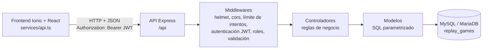

Cada solicitud pasa por los middlewares de seguridad, luego por las reglas de validación de su ruta y
finalmente por el controlador, que aplica las reglas de negocio y usa los modelos para consultar la
base de datos. Los errores se transforman en un único formato JSON en el manejador central.

### Estructura de carpetas

```
RePlay-Games/
├── README.md
├── capturas/                     # Capturas de EP1 y, en ep2/, del flujo integrado
├── database/
│   └── replay_games.sql          # Modelo relacional + datos de ejemplo (reproducible)
├── postman/
│   ├── RePlay-Games.postman_collection.json
│   ├── RePlay-Games.postman_environment.json
│   ├── generar-reporte.js        # Convierte el reporte de newman en resultados/resultados.md
│   └── resultados/resultados.md  # Evidencia de la última ejecución
├── backend/
│   ├── .env.example              # Variables de entorno documentadas (sin secretos)
│   ├── package.json
│   └── src/
│       ├── server.js             # Arranque: verifica la BD y abre el puerto
│       ├── app.js                # Express: helmet, cors, JSON, rutas y manejo de errores
│       ├── config/               # env.js (variables de entorno) y db.js (pool mysql2)
│       ├── middlewares/          # autenticacion, autorizacion, validar, errores
│       ├── validators/           # Reglas de express-validator por recurso
│       ├── controllers/          # auth, usuarios, publicaciones, operaciones, catalogos
│       ├── models/               # Consultas SQL parametrizadas y mapeo a JSON
│       ├── routes/               # Definición de endpoints bajo /api
│       └── utils/                # ErrorHttp y emisión/verificación de JWT
└── frontend/
    ├── .env.example              # VITE_API_URL
    └── src/
        ├── App.tsx               # Split pane + menú + tabs según el rol
        ├── components/           # Componentes reutilizables
        ├── context/              # Sesión: valida el token y reacciona a su expiración
        ├── data/                 # Catálogos fijos de formularios y cuenta de prueba
        ├── models/               # Tipos del dominio (iguales a las respuestas de la API)
        ├── pages/                # Una página por ruta
        ├── routes/               # Rutas, control de acceso y secciones de navegación
        ├── services/             # api.ts (cliente HTTP) y un servicio por recurso
        ├── theme/                # Estilos
        └── utils/                # Formato de precios y fechas
```

### Instalación y ejecución

Requisitos: **Node.js 20.19+ o 22.12+**, npm y **MySQL 8** o **MariaDB 10.4+** (XAMPP sirve).

**1. Base de datos.** El script crea la base `replay_games` desde cero con sus datos de ejemplo:

```bash
mysql -u root -p < database/replay_games.sql
```

También se puede importar desde **phpMyAdmin** (pestaña *Importar*) o abrir y ejecutar el archivo en
**MySQL Workbench**. Volver a ejecutarlo deja la base en su estado inicial.

Opcionalmente, crear un usuario con permisos mínimos para la API en lugar de usar `root`:

```sql
CREATE USER 'replay_app'@'localhost' IDENTIFIED BY 'cambia-esta-clave';
GRANT SELECT, INSERT, UPDATE, DELETE ON replay_games.* TO 'replay_app'@'localhost';
```

**2. Backend** (queda en <http://localhost:3000/api>):

```bash
cd backend
npm install
cp .env.example .env        # en Windows: copy .env.example .env
```

Editar `backend/.env`: completar `DB_USER` y `DB_PASSWORD` y escribir en `JWT_SECRET` un texto aleatorio
de al menos 32 caracteres. Se puede generar con:

```bash
node -e "console.log(require('crypto').randomBytes(48).toString('hex'))"
```

```bash
npm run dev                 # o npm start
```

Para comprobarlo, abrir <http://localhost:3000/api/salud>, que debe responder
`{"estado":"ok","baseDatos":"conectada"}`.

**3. Frontend** (queda en <http://localhost:5173>), en otra terminal:

```bash
cd frontend
npm install
npm run dev
```

El frontend usa `http://localhost:3000/api` por defecto. Para otra dirección, copiar
`frontend/.env.example` como `frontend/.env` y cambiar `VITE_API_URL`.

| Comando | Carpeta | Descripción |
| :--- | :--- | :--- |
| `npm run dev` | `backend/` | API con recarga automática al guardar cambios. |
| `npm start` | `backend/` | API en modo normal. |
| `npm run test:api` | `backend/` | Ejecuta la colección de Postman con newman y genera `postman/resultados/resultados.md`. |
| `npm run dev` | `frontend/` | Servidor de desarrollo de Vite. |
| `npm run build` | `frontend/` | Verifica los tipos y genera la versión de producción. |

#### Cuentas de prueba

Todas las cuentas de ejemplo usan la contraseña `replay123`.

| Correo | Rol | Uso sugerido |
| :--- | :--- | :--- |
| `usuario@replay.cl` | usuario | Vendedor con publicaciones, compras y ventas. |
| `camila@replay.cl` | usuario | Segunda cuenta para comprar publicaciones de la primera. |
| `diego@replay.cl`, `fernanda@replay.cl` | usuario | Cuentas adicionales. |
| `admin@replay.cl` | administrador | Administración de usuarios y moderación. |

#### Problemas frecuentes

| Síntoma | Causa y solución |
| :--- | :--- |
| `Falta la variable de entorno JWT_SECRET` al iniciar el backend | No existe `backend/.env` o está incompleto. Copiar `.env.example` y completar los valores. |
| `No fue posible conectar con la base de datos` | MySQL no está iniciado, no se importó `database/replay_games.sql` o `DB_USER`/`DB_PASSWORD` no coinciden. |
| El frontend muestra "No fue posible conectar con el servidor" | El backend no está en ejecución o `VITE_API_URL` apunta a otra dirección. |
| Error de CORS en la consola del navegador | El origen del frontend no está en `CORS_ORIGIN` de `backend/.env` (`.env.example` incluye `http://localhost:5173` y `http://localhost:8100`). |
| `429 Demasiados intentos fallidos` | Se superó el límite de intentos fallidos de login/registro. Esperar 15 minutos, reiniciar el backend o subir `AUTH_MAX_INTENTOS` en `.env`. |
| Tildes o "ñ" con caracteres extraños | La base se importó con otra codificación. Volver a ejecutar el script completo, que fuerza `utf8mb4`. |

### Documentación de la API

- **URL base:** `http://localhost:3000/api`
- **Formato:** JSON en solicitudes y respuestas.
- **Autenticación:** encabezado `Authorization: Bearer <token>` con el token entregado por el login o el registro.
- **Errores:** siempre `{ "mensaje": "...", "errores": [{ "campo": "...", "mensaje": "..." }] }`; `errores` solo aparece cuando hay datos inválidos.

#### Endpoints

| Método | Ruta | Acceso | Descripción | Respuestas |
| :--- | :--- | :--- | :--- | :--- |
| GET | `/salud` | Público | Estado de la API y de la base de datos | 200 |
| GET | `/catalogos` | Público | Consolas, géneros, estados, modalidades, regiones y comunas | 200 |
| POST | `/auth/registro` | Público | Crea una cuenta con rol usuario e inicia sesión | 201, 400, 409, 429 |
| POST | `/auth/login` | Público | Inicia sesión y entrega el JWT | 200, 400, 401, 403, 429 |
| GET | `/auth/perfil` | Sesión | Datos de la cuenta autenticada | 200, 401 |
| PATCH | `/usuarios/perfil` | Sesión | Actualiza nombre de usuario, región o comuna propios | 200, 400, 401, 409 |
| GET | `/usuarios/:id` | Público | Perfil público del vendedor (sin correo) | 200, 400, 404 |
| GET | `/usuarios` | Administrador | Lista de cuentas | 200, 401, 403 |
| PATCH | `/usuarios/:id/estado` | Administrador | Activa o desactiva una cuenta | 200, 400, 401, 403, 404 |
| GET | `/publicaciones` | Público | Catálogo con filtros `texto`, `consola`, `genero`, `estadoConservacion`, `comuna`, `precioMaximo` | 200, 400 |
| GET | `/publicaciones/mias` | Usuario | Publicaciones propias en cualquier estado | 200, 401, 403 |
| GET | `/publicaciones/:id` | Público | Detalle de una publicación | 200, 400, 404 |
| POST | `/publicaciones` | Usuario | Crea una publicación | 201, 400, 401, 403 |
| PUT | `/publicaciones/:id` | Dueño | Reemplaza los datos de una publicación propia | 200, 400, 401, 403, 404, 409 |
| PATCH | `/publicaciones/:id/estado` | Dueño | Pausa o reactiva (`activa` / `pausada`) | 200, 400, 401, 403, 404, 409 |
| DELETE | `/publicaciones/:id` | Dueño o administrador | Elimina una publicación sin operaciones | 204, 401, 403, 404, 409 |
| PATCH | `/publicaciones/:id/moderacion` | Administrador | Oculta o vuelve a mostrar una publicación | 200, 400, 401, 403, 404 |
| GET | `/operaciones` | Usuario | Compras y ventas de la cuenta, con publicación y contraparte | 200, 401, 403 |
| POST | `/operaciones` | Usuario | Solicitud de compra; queda `pendiente` | 201, 400, 401, 403, 404, 409 |
| PATCH | `/operaciones/:id/estado` | Comprador o vendedor | Cambia el estado según las reglas de abajo | 200, 400, 401, 403, 404, 409 |

Significado de los códigos: **200** correcto, **201** creado (con encabezado `Location`), **204** eliminado
sin contenido, **400** datos inválidos, **401** sin sesión o token inválido/expirado, **403** sesión
válida sin permiso (rol o dueño), **404** no existe, **409** conflicto con el estado actual (correo
duplicado, publicación vendida, transición no permitida...), **429** demasiados intentos, **500** error
inesperado (sin detalles internos).

#### Reglas de las operaciones

| Quién | Desde | Puede pasar a |
| :--- | :--- | :--- |
| Vendedor | `pendiente` | `confirmada` o `cancelada` |
| Vendedor | `confirmada` | `completada` o `cancelada` |
| Comprador | `pendiente` | `cancelada` |

Al completar una operación, la publicación queda `vendida` y las demás solicitudes en curso sobre ella se
cancelan (en una transacción). No se puede comprar una publicación propia, pausada, vendida u oculta, ni
repetir una solicitud en curso. Una publicación con operaciones no se elimina: se puede pausar.

#### Ejemplos

Inicio de sesión:

```http
POST /api/auth/login
Content-Type: application/json

{ "correo": "usuario@replay.cl", "clave": "replay123" }
```

```json
{
  "token": "eyJhbGciOiJIUzI1NiIsInR5cCI6IkpXVCJ9...",
  "expiraEn": "2h",
  "usuario": {
    "id": 1,
    "nombreUsuario": "sebastian_r",
    "correo": "usuario@replay.cl",
    "rol": "usuario",
    "region": "Valparaíso",
    "comuna": "Valparaíso",
    "reputacion": 4.8,
    "totalCalificaciones": 12,
    "fechaRegistro": "2026-03-14",
    "activo": true
  }
}
```

Crear una publicación:

```http
POST /api/publicaciones
Authorization: Bearer <token>
Content-Type: application/json

{
  "titulo": "Hollow Knight",
  "consola": "Nintendo Switch",
  "genero": "Plataformas",
  "estadoConservacion": "Como nuevo",
  "precio": 15990,
  "descripcion": "Cartucho en perfecto estado, con caja original.",
  "region": "Valparaíso",
  "comuna": "Quilpué",
  "entregas": ["Retiro en persona", "Envío por pagar"],
  "incluyeCaja": true,
  "incluyeManual": false
}
```

Respuesta `201 Created` con la publicación creada (`id`, `estadoPublicacion: "activa"`, `vendedorId`,
`fechaPublicacion`...). Si faltan datos, `400 Bad Request`:

```json
{
  "mensaje": "Revisa los datos enviados.",
  "errores": [
    { "campo": "titulo", "mensaje": "El título debe tener entre 3 y 120 caracteres." },
    { "campo": "entregas", "mensaje": "Elige al menos una modalidad de entrega." }
  ]
}
```

Solicitar una compra (`POST /api/operaciones`):

```json
{ "publicacionId": 13, "modalidadEntrega": "Envío por pagar" }
```

Cambiar el estado de una operación (`PATCH /api/operaciones/7/estado`):

```json
{ "estado": "confirmada" }
```

La colección de Postman contiene un ejemplo listo para cada endpoint, incluidos los casos de error.

### Seguridad

| Medida | Implementación |
| :--- | :--- |
| Contraseñas con bcrypt | `bcryptjs` con 10 rondas al registrar y `bcrypt.compare` al iniciar sesión. Solo se guarda el hash, que nunca se devuelve. Si el correo no existe se compara contra un hash de referencia, para no revelar por tiempo de respuesta qué correos están registrados. |
| JWT | Firmado con HS256 y `JWT_SECRET` (mínimo 32 caracteres; el servidor no arranca sin él). Contiene solo `sub` (id) y `rol`, y expira según `JWT_EXPIRES_IN` (2 horas por defecto). |
| Verificación en cada solicitud | El middleware de autenticación vuelve a leer el usuario en la base: una cuenta desactivada pierde el acceso de inmediato y el rol usado siempre es el vigente. |
| Roles | Tabla `roles` (usuario, administrador) y middleware `permitirRoles(...)`. 401 cuando falta sesión y 403 cuando el rol o el dueño no corresponden. El rol de administrador no compra ni publica, como indica la matriz de acceso. |
| Validación de entradas | `express-validator` en todos los endpoints (tipos, largos, formatos, listas permitidas) más reglas de negocio en los controladores (comuna de la región indicada, modalidad ofrecida por el vendedor, transiciones válidas). |
| SQL parametrizado | Todas las consultas usan `pool.execute(sql, parámetros)`; no hay SQL construido concatenando datos del usuario. En la búsqueda se escapan los comodines de `LIKE`. |
| Secretos fuera del código | Credenciales de la base y clave JWT en `backend/.env`, ignorado por git; `backend/.env.example` documenta cada variable sin valores secretos. |
| CORS restringido | Solo los orígenes de `CORS_ORIGIN` pueden consumir la API desde el navegador. |
| Encabezados HTTP | `helmet` (oculta `X-Powered-By`, evita *sniffing* de contenido, etc.) y límite de 100 kB por solicitud. |
| Fuerza bruta | `express-rate-limit`: máximo `AUTH_MAX_INTENTOS` intentos fallidos de login o registro por IP cada 15 minutos (429). |
| Minimización de datos | El perfil público no incluye el correo; la lista con correos es solo para el administrador; el registro pide únicamente los datos definidos en EP1. |
| Integridad en la base | Claves foráneas, `UNIQUE` en correo y nombre de usuario, `CHECK` de precio, largos y comprador distinto del vendedor, y transacciones al crear/editar publicaciones y completar operaciones. |

### Integración frontend + backend

- `frontend/src/services/api.ts` centraliza la conexión: arma la URL con `VITE_API_URL`, agrega
  `Authorization: Bearer <token>`, transforma las respuestas de error en `ErrorApi` (código, mensaje y
  errores por campo) y, si la API responde 401 a una solicitud con token, borra la sesión y emite el
  evento `replay:sesion-expirada`.
- `context/SesionContext.tsx` valida el token guardado con `GET /auth/perfil` al abrir la aplicación y
  cierra la sesión cuando recibe ese evento; las rutas protegidas redirigen entonces a `/login`
  recordando la página solicitada.
- `routes/Protegida.tsx` exige sesión y rol en cada ruta protegida, y `routes/navegacion.ts` define qué
  secciones muestran el menú lateral y la barra inferior para cada rol.
- Los servicios mantienen las mismas funciones de EP1, por lo que las páginas casi no cambiaron:

| Servicio del frontend | Endpoint |
| :--- | :--- |
| `iniciarSesion`, `registrar`, `verificarSesion` | `POST /auth/login`, `POST /auth/registro`, `GET /auth/perfil` |
| `listarPublicaciones`, `obtenerPublicacion` | `GET /publicaciones`, `GET /publicaciones/:id` |
| `listarMisPublicaciones`, `crearPublicacion`, `actualizarPublicacion` | `GET /publicaciones/mias`, `POST /publicaciones`, `PUT /publicaciones/:id` |
| `cambiarEstadoPublicacion`, `eliminarPublicacion` | `PATCH /publicaciones/:id/estado`, `DELETE /publicaciones/:id` |
| `obtenerUsuario`, `listarUsuarios`, `cambiarEstadoUsuario` | `GET /usuarios/:id`, `GET /usuarios`, `PATCH /usuarios/:id/estado` |
| `listarOperaciones`, `crearOperacion`, `cambiarEstadoOperacion` | `GET /operaciones`, `POST /operaciones`, `PATCH /operaciones/:id/estado` |

#### Capturas del flujo integrado

| | |
| :---: | :---: |
| 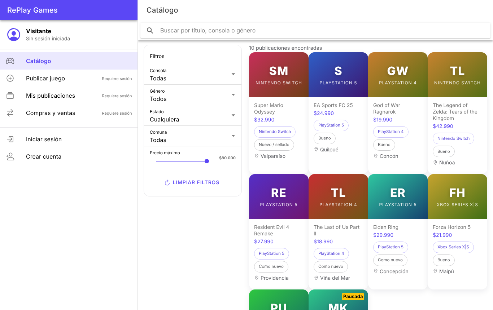 Catálogo cargado desde la API | 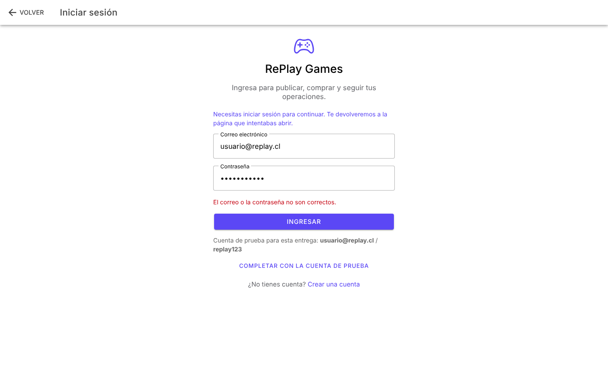 Error de credenciales devuelto por la API (401) |
| 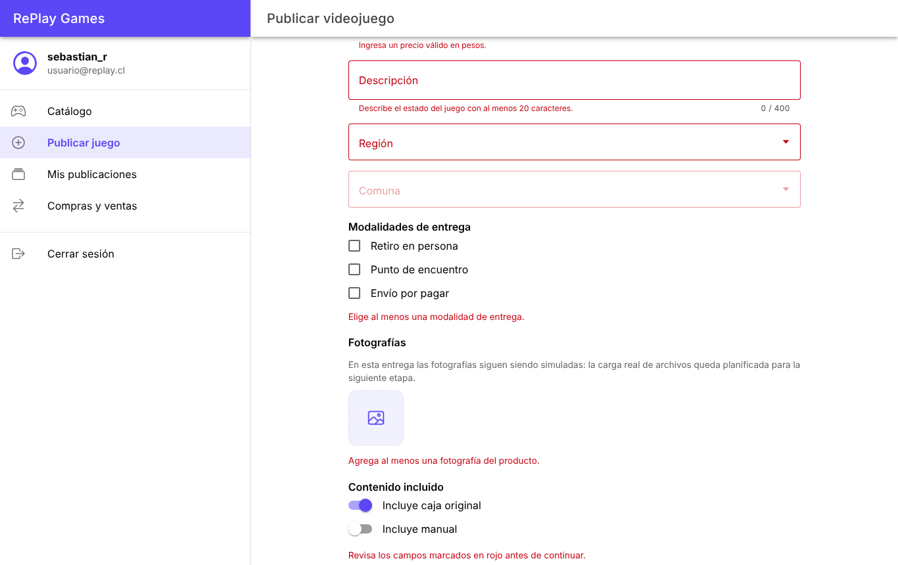 Validación del formulario de publicación | 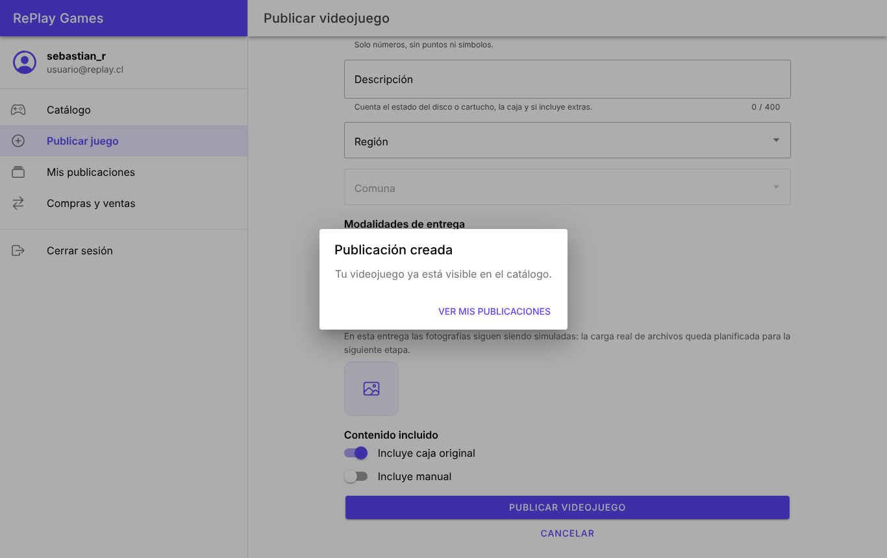 Publicación guardada en la base de datos |
| 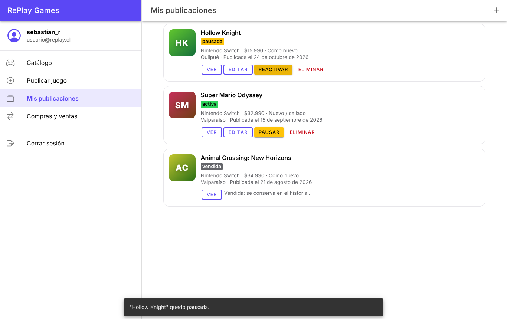 Mis publicaciones: pausar, editar y eliminar | 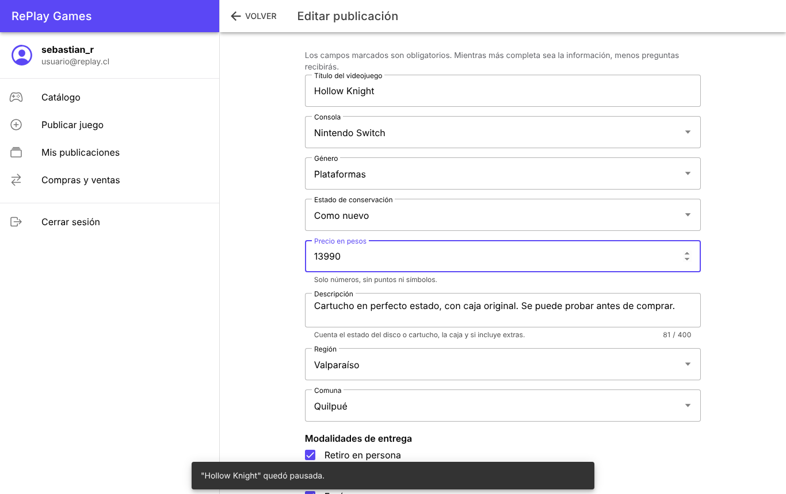 Edición de una publicación propia (PUT) |
| 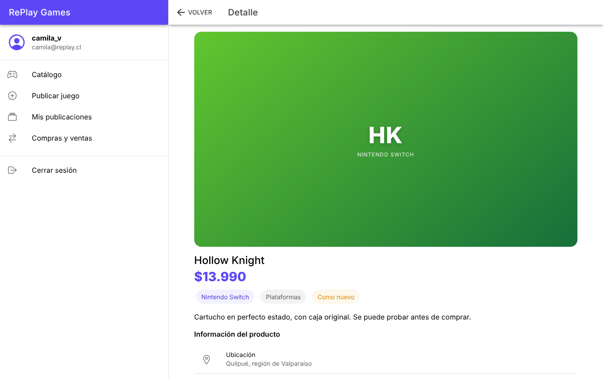 Detalle con datos del vendedor | 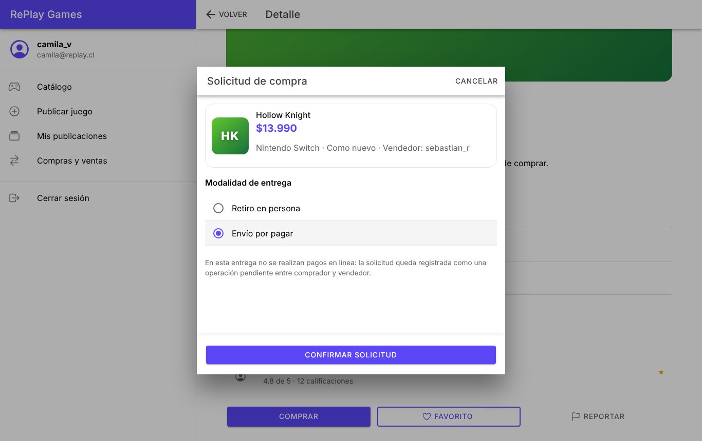 Solicitud de compra con modalidad de entrega |
| 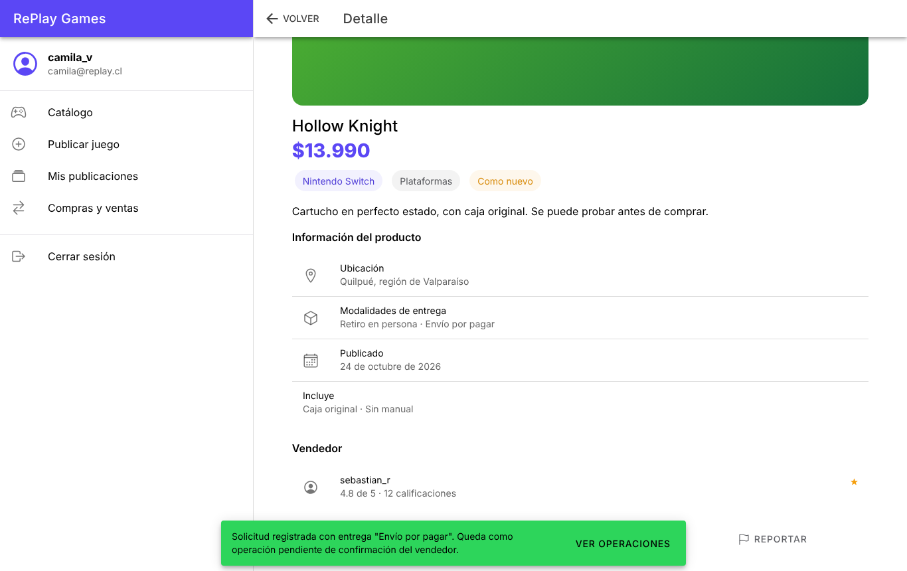 Operación creada (POST /operaciones) | 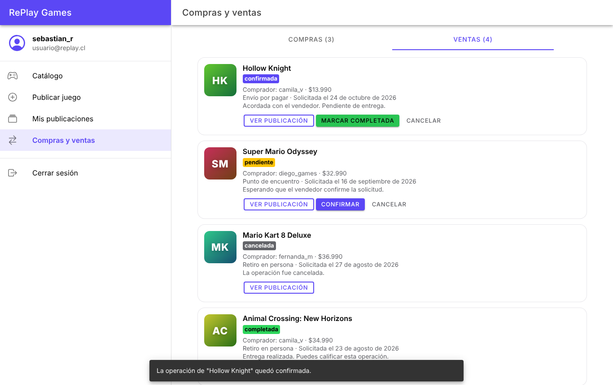 El vendedor confirma y completa |
| 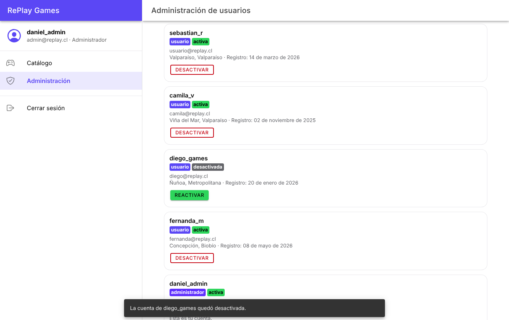 Administrador desactiva una cuenta | 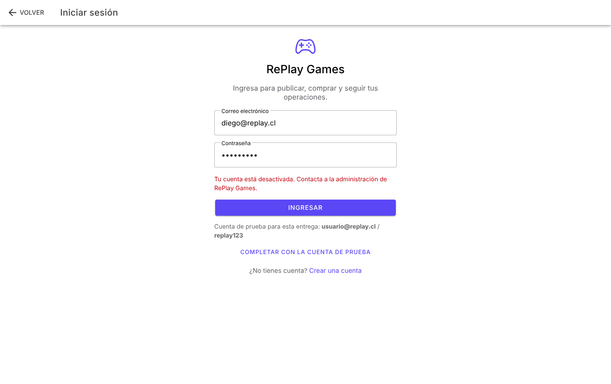 La cuenta desactivada no puede entrar (403) |
| 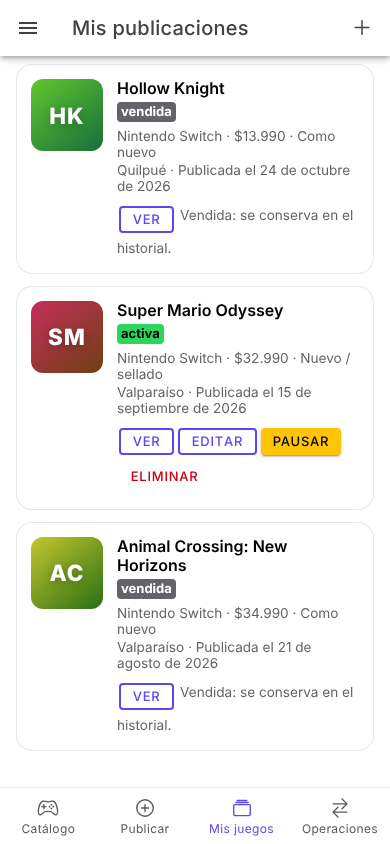 Vista móvil con barra inferior | |

### Pruebas con Postman

La carpeta `postman/` contiene la colección `RePlay-Games.postman_collection.json` y el environment
`RePlay-Games.postman_environment.json`.

**Desde Postman:** *Import* → seleccionar ambos archivos → elegir el environment
**RePlay Games - local** → abrir la colección → **Run**. Las solicitudes deben ejecutarse en orden,
porque los logins guardan los tokens y la creación de recursos guarda sus identificadores en el
environment. Cada ejecución usa un correo nuevo, así que se puede repetir sin reiniciar la base.

**Desde la consola** (con el backend en ejecución):

```bash
cd backend
npm run test:api
```

Ese comando ejecuta la colección con newman y escribe la evidencia en
[`postman/resultados/resultados.md`](postman/resultados/resultados.md): cada solicitud con su código
HTTP, sus pruebas y la respuesta recibida (los tokens se reemplazan por un marcador).

Resultado de la ejecución registrada: **64 solicitudes, 149 pruebas, 0 fallidas**. La colección se
ejecutó contra MySQL 8.0 y contra MariaDB 10.11 con el mismo resultado.

| Carpeta | Solicitudes | Casos exitosos | Casos de error |
| :--- | :---: | :---: | :---: |
| 0. Salud del servidor | 1 | 1 | 0 |
| 1. Autenticación | 10 | 5 | 5 (400, 401 ×3, 409) |
| 2. Catálogo y perfiles públicos | 9 | 6 | 3 (400 ×2, 404) |
| 3. Publicaciones | 16 | 8 | 8 (400 ×3, 401, 403 ×3, 404) |
| 4. Operaciones | 13 | 4 | 9 (400, 403 ×2, 409 ×6) |
| 5. Eliminar publicación | 4 | 2 | 2 (403, 404) |
| 6. Administración y roles | 9 | 4 | 5 (400, 401 ×2, 403 ×2) |
| 7. Errores generales | 2 | 0 | 2 (400, 404) |
| **Total** | **64** | **30** | **34** |

Además de los códigos HTTP, las pruebas verifican, entre otras cosas, que el token solo contenga `sub`
y `rol`, que ninguna respuesta incluya contraseñas o hashes, que el perfil público no exponga el
correo, que un visitante no vea una publicación oculta y que una cuenta desactivada pierda el acceso
con su token anterior.

### Modelo relacional

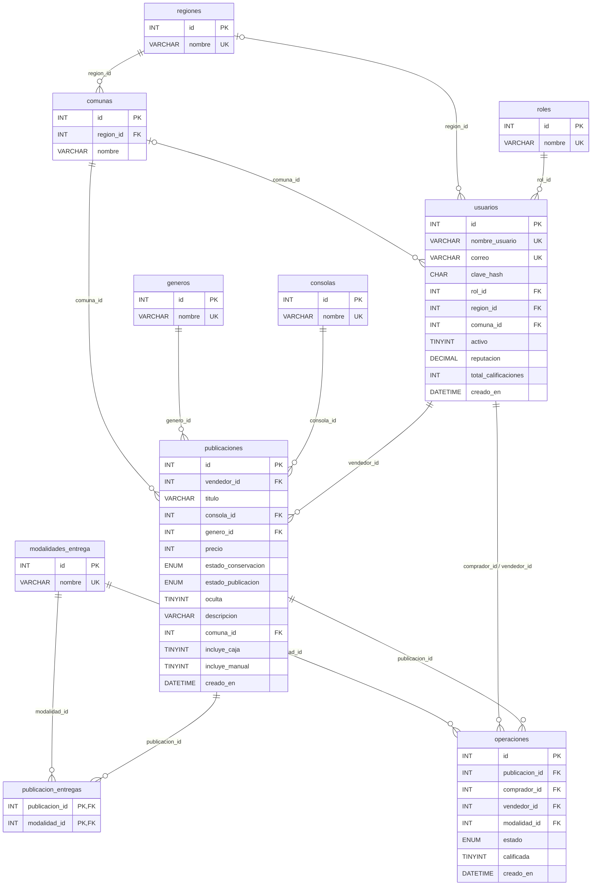

| Tabla | Propósito | Restricciones principales |
| :--- | :--- | :--- |
| `roles` | Roles del sistema (usuario, administrador). | `UNIQUE(nombre)` |
| `regiones`, `comunas` | Ubicaciones normalizadas; cada comuna pertenece a una región. | FK `comunas.region_id`, `UNIQUE(region_id, nombre)` |
| `consolas`, `generos`, `modalidades_entrega` | Catálogos estandarizados de los formularios y filtros. | `UNIQUE(nombre)` |
| `usuarios` | Cuentas, rol, ubicación opcional, estado y reputación. | `UNIQUE(correo)`, `UNIQUE(nombre_usuario)`, FK a `roles`, `regiones`, `comunas`, `CHECK` reputación 0–5 |
| `publicaciones` | Videojuegos publicados, su estado y si están ocultos por moderación. | FK a `usuarios`, `consolas`, `generos`, `comunas`; `CHECK` precio 1–500.000, título ≥ 3 y descripción ≥ 20 caracteres |
| `publicacion_entregas` | Modalidades de entrega de cada publicación (muchos a muchos). | PK compuesta; `ON DELETE CASCADE` desde `publicaciones` |
| `operaciones` | Solicitudes de compra y su estado. Guarda el vendedor para conservar el historial. | FK a `publicaciones`, `usuarios` (comprador y vendedor) y `modalidades_entrega`; `CHECK` comprador distinto del vendedor |

### Matriz de cumplimiento EP2

| Criterio | Evidencia en el repositorio |
| :--- | :--- |
| EP 2.1 Servidor | `backend/src/server.js` y `backend/src/app.js`; módulos en `config`, `routes`, `controllers`, `models`, `middlewares`, `validators`; pasos de instalación en este README. |
| EP 2.2 Base relacional | `database/replay_games.sql`: 10 tablas con claves foráneas, `UNIQUE` y `CHECK`, datos de ejemplo y script reproducible; diagrama y tabla del modelo en esta sección; conexión con pool `mysql2`. |
| EP 2.3 API REST | 20 endpoints JSON con GET, POST, PUT, PATCH y DELETE y códigos 200, 201, 204, 400, 401, 403, 404, 409, 429 y 500. |
| EP 2.4 JWT y roles | Registro y login con JWT con expiración, `GET /auth/perfil`, rutas protegidas, roles usuario y administrador con pruebas de acceso no permitido. |
| EP 2.5 Seguridad | bcrypt, express-validator, `.env` + `.env.example`, SQL parametrizado, helmet, CORS restringido y límite de intentos (ver sección Seguridad). |
| EP 2.6 Ionic React + backend | `frontend/src/services/api.ts`, servicios por recurso, envío del JWT, manejo de errores y de expiración del token, guardias de ruta y capturas en `capturas/ep2/`. |
| EP 2.7 Pruebas | Colección y environment en `postman/`, 64 solicitudes con 34 casos de error, resultados exportados en `postman/resultados/resultados.md`. |
| Documentación | Este README: alcance, ramas, tecnologías, arquitectura, ejecución, API, seguridad, integración, pruebas y modelo relacional. |

#### Lista de verificación antes de la entrega

- [ ] Importar `database/replay_games.sql` en una base limpia.
- [ ] Crear `backend/.env` con una `JWT_SECRET` propia y no subirlo al repositorio.
- [ ] Iniciar el backend y comprobar `GET /api/salud`.
- [ ] Ejecutar `npm run test:api` sin pruebas fallidas.
- [ ] Ejecutar `npm run build` en `frontend/` sin errores.
- [ ] Probar en el navegador el login de `usuario@replay.cl` y de `admin@replay.cl`.
- [ ] Integrar la rama de trabajo en `main` y entregar el enlace del repositorio.

### Pendiente para las próximas entregas

- Favoritos (RF-05), calificaciones (RF-08) y reportes con panel de moderación (RF-09, RF-10).
- Carga y almacenamiento real de fotografías.
- Perfil de usuario en el frontend (la API ya permite actualizarlo con `PATCH /usuarios/perfil`).
- Despliegue con Docker y docker-compose.

### Capturas de pantalla de EP1

Catálogo de juegos


------------------------------------------------------------

Inicio de sesión


------------------------------------------------------------

Crear cuenta


------------------------------------------------------------

Detalle de juego


------------------------------------------------------------

Filtros


------------------------------------------------------------

Publicar videojuego


------------------------------------------------------------

Compras y ventas


------------------------------------------------------------

## Librerías usadas con React (Ionic)

### Librerías principales

| Librería | Propósito |
| :--- | :--- |
| `@ionic/react` | Componentes de interfaz de Ionic adaptados a React: páginas, listas, formularios, modales y barra de pestañas. |
| `@ionic/react-router` | Integración de Ionic con React Router: contenedor de rutas, animaciones de transición y pila de navegación. |
| `react-router-dom` | Enrutamiento del lado del cliente: definición de rutas, parámetros y redirecciones. |
| `ionicons` | Conjunto de iconos oficial de Ionic, usado en el menú, las pestañas y las acciones. |
| `vite` | Servidor de desarrollo con recarga en caliente y empaquetado para producción. |
| `typescript` | Tipado estático del dominio y verificación previa a la construcción. |

No se utilizan librerías de estilos externas: el diseño se construye sobre las variables CSS de
Ionic y una hoja de estilos propia (`src/theme/`), lo que permite el modo claro y oscuro automático.

## Tecnologías

- **Ionic Framework** (`@ionic/react` 8.8.x, `@ionic/react-router` 8.8.x)
- **React** 18.3.x y **React DOM** 18.3.x
- **React Router** 5.3.x (`react-router`, `react-router-dom`)
- **TypeScript** 5.9.x
- **Vite** 7.x como herramienta de construcción
- **Ionicons** 8.x
- **CSS de Ionic** con variables propias de tema
- **Figma** para el prototipo
- **Git y GitHub** para el control de versiones

> Se utiliza la línea 8 de Ionic porque la versión 9, publicada durante el desarrollo de esta
> entrega, migra a React Router 6 y modifica la forma de declarar las rutas.

**Incorporadas en EP2:** Node.js con Express 5, MySQL 8 / MariaDB con `mysql2`, autenticación con
JWT (`jsonwebtoken`) y `bcryptjs`, validación con `express-validator`, seguridad con `helmet`, `cors` y
`express-rate-limit`, y pruebas de API con Postman y newman (ver
[Tecnologías por capa](#tecnologías-por-capa)).

**Planificada para entregas posteriores:** Docker con docker-compose para el despliegue.

## Fuentes

[1] Cámara de Comercio de Santiago (CCS). *Comercio electrónico bordeó los US$ 10 mil millones en
2025.* <https://www.ccs.cl/area-publicacion/comercio-electronico-y-economia-digital/>

[2] SERNAC. *Tus derechos en el Comercio Electrónico.*
<https://www.sernac.cl/portal/618/w3-propertyvalue-20982.html>

[3] SERNAC. *Derechos y deberes en el consumo.* Referencia sobre información de productos usados.
<https://www.sernac.cl/portal/617/w3-propertyvalue-8321.html>

[4] Meta — Facebook Help Center. *How ratings work on Facebook Marketplace.*
<https://www.facebook.com/help/915385548593204/>

[5] Sandra Cano — PUCV. *README de ejemplo para EP1.*
<https://github.com/SandraCano-PUCV/IngenieriaWebMovil/blob/main/EP/EP1/Readme.md>

[6] Sandra Cano — PUCV. *Ejemplo EP2 con JWT y rúbrica de evaluación.*
<https://github.com/SandraCano-PUCV/IngenieriaWebMovil/tree/main/EP/EP2%2BJWT>

[7] Express. *Documentación de Express 5.* <https://expressjs.com/>

[8] OWASP. *Password Storage Cheat Sheet* y *SQL Injection Prevention Cheat Sheet.*
<https://cheatsheetseries.owasp.org/>

[9] IETF. *RFC 7519: JSON Web Token (JWT).* <https://www.rfc-editor.org/rfc/rfc7519>
